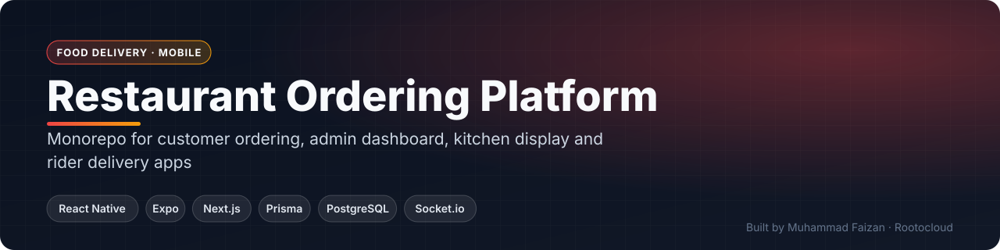
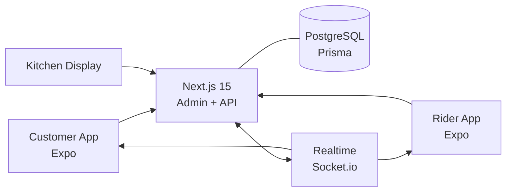

 

     

 

**[Request a live demo](https://rootocloud.com) · [Hire me](mailto:faizan.developer9200@gmail.com) · [More projects](https://github.com/MuhammadFaizan73)**

---

## 📌 Overview

A full restaurant ordering platform: customers order and track in a mobile app, the restaurant runs an admin panel and kitchen display, and riders handle deliveries in their own app — all behind one Next.js backend and a shared PostgreSQL database, with real-time updates.

## ✨ Key Features

### Customer App
- Browse menu and place orders
- Live order tracking

### Restaurant
- Admin panel with menu, orders and analytics
- Kitchen Display System at /kitchen

### Delivery
- Rider app with delivery flow
- Real-time status over Socket.io / Pusher

## 🏗️ Architecture

## 🧰 Tech Stack

| Layer | Technology |
|---|---|
| **Customer & Rider apps** | React Native (Expo) |
| **Admin + API** | Next.js 15 (App Router) · API routes |
| **Database** | PostgreSQL · Prisma |
| **Realtime** | Socket.io server (or Pusher) |
| **Auth** | JWT for mobile |
| **Dev** | Docker Compose |

<!-- SCREENSHOTS -->
<!-- /SCREENSHOTS -->

## 🔒 About the Source Code

This is a **commercial / client project**, so the source code is kept in a private repository.
This page documents what the system does and how it is built.

- 🎥 **Live walkthrough** — available on request
- 💼 **Want something similar for your business?** I build custom versions of this for clients.

## 👨‍💻 Author

**Muhammad Faizan** — Founder, [Rootocloud](https://rootocloud.com)
AI agents & automation · Web & mobile apps · Custom software

© Muhammad Faizan. All rights reserved.

